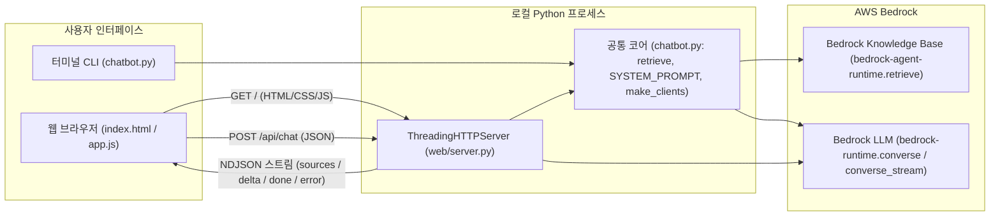
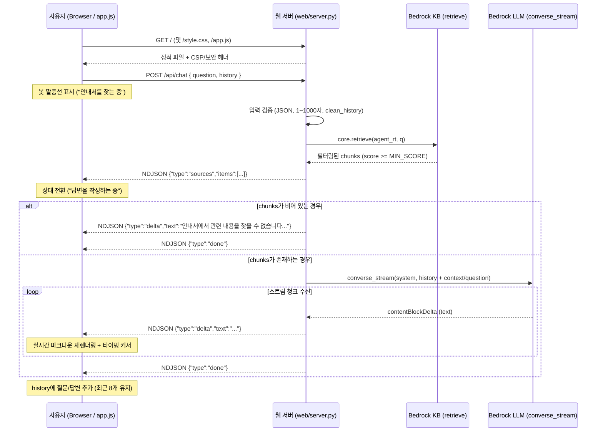

# SWFA_AWS 프로젝트 레퍼런스 (교통약자 이용 안내 챗봇)

> 이 문서는 `SWFA_AWS` 프로젝트의 코드 구조, 핵심 실행 흐름, API 프로토콜, 프롬프트 정책 및 구현 세부사항을 정리한 참고 문서입니다.

---

## 1. 프로젝트 개요

**SWFA_AWS**는 부산 지역 교통약자를 위한 **대중교통 이용 안내 RAG(Retrieval-Augmented Generation) 챗봇**입니다.  
AWS Bedrock Knowledge Base에서 안내서 문서를 벡터 검색한 뒤, 검색된 발췌본만을 근거로 AWS Bedrock LLM(Claude)이 답변을 생성합니다.

- **핵심 대상 도메인**: 저상버스 이용, 휠체어 환승 경로, 지하철 엘리베이터, 교통약자 편의시설
- **실행 방식**:
  1. **CLI 모드** (`chatbot.py`): 터미널 기반 대화형 챗봇 (`converse` API)
  2. **Web 모드** (`web/server.py` + `web/static/*`): 경량 Python HTTP 서버 + NDJSON 스트리밍(`converse_stream` API) + Vanilla JS 웹 UI
- **외부 의존성**: Python `boto3` (`botocore` 포함)만 사용. 웹 백엔드(표준 라이브러리 `http.server`)와 프론트엔드(순수 HTML/CSS/JS) 모두 별도 프레임워크 없이 구현됨.

---

## 2. 디렉터리 구조 및 파일별 역할

```text
SWFA_AWS/
├── .env                    # AWS 자격증명 및 Bedrock/KB 설정 (.gitignore 대상)
├── .gitignore              # .env 제외
├── chatbot.py              # [핵심 엔진 + CLI] 환경 로드, KB 검색, 프롬프트, Converse 호출, CLI 루프
└── web/
    ├── server.py           # [웹 서버] ThreadingHTTPServer, 정적 파일 서빙, /api/chat 스트리밍 API
    └── static/
        ├── index.html      # 채팅 UI 마크업 (신호등 헤더, 환영 화면, 입력 폼)
        ├── app.js          # 스트림 처리, 자체 마크다운 렌더러, 근거 툴팁, 예시 순환, 신호등 인터랙션
        └── style.css       # 라이트/다크 테마, 접근성, 타이핑/로딩 애니메이션, 신호등 빛 효과
```

| 파일 | 역할 | 주요 진입점 / 심볼 |
| :--- | :--- | :--- |
| `chatbot.py` | 공통 코어 모듈 및 CLI 앱 | `load_env()`, `make_clients()`, `source_name()`, `retrieve()`, `answer()`, `explain_error()`, `main()`, `SYSTEM_PROMPT` |
| `web/server.py` | 멀티스레드 웹 서버 (`chatbot.py`를 `core`로 임포트) | `clean_history()`, `Handler.do_GET()`, `Handler.do_POST()`, `Handler._emit()` |
| `web/static/index.html` | 단일 페이지 채팅 레이아웃 | `#signal`, `#reset`, `#chat`, `#welcome`, `#chips`, `#form`, `#input`, `#send` |
| `web/static/app.js` | 클라이언트 로직 및 UI 인터랙션 | `inline()`, `render()`, `ask()`, `showTip()`, `paint()`, `rotate()` |
| `web/static/style.css` | 반응형/테마 스타일 및 애니메이션 | `@media (prefers-color-scheme: dark)`, `@media (prefers-reduced-motion: reduce)`, `.cite`, `.tip`, `.signal` |

---

## 3. 환경변수 및 설정

`chatbot.py` 로드 시 프로젝트 루트의 `.env` 파일을 `load_env()`로 파싱하며, `os.environ.setdefault()`를 사용하므로 **이미 설정된 OS 환경변수가 `.env`보다 우선**합니다. `web/server.py`는 `chatbot`을 임포트하면서 동일한 설정을 자동 로드합니다.

| 변수명 | 필수 여부 | 기본값 | 설명 |
| :--- | :---: | :--- | :--- |
| `AWS_ACCESS_KEY_ID` | 조건부 | - | AWS 액세스 키 (`~/.aws` 프로파일이 없을 때 필요) |
| `AWS_SECRET_ACCESS_KEY` | 조건부 | - | AWS 시크릿 키 |
| `AWS_REGION` (`AWS_DEFAULT_REGION`) | 선택 | `ap-northeast-2` | AWS Bedrock 및 KB 리전 |
| `KB_ID` | **필수** | `""` | AWS Bedrock Knowledge Base ID (미설정 시 프로세스 종료) |
| `MODEL_ID` | 선택 | `us.anthropic.claude-sonnet-4-5-20250929-v1:0` | Bedrock LLM 모델/추론 프로파일 ID |
| `TOP_K` | 선택 | `5` | 벡터 검색 시 KB에서 가져올 최대 청크 수 |
| `MIN_SCORE` | 선택 | `0.3` | 검색 결과 필터링 최소 유사도 점수 |
| `HOST` | 선택 | `127.0.0.1` | 웹 서버 바인딩 호스트 (`web/server.py` 전용) |
| `PORT` | 선택 | `8000` | 웹 서버 포트 (`web/server.py` 전용) |

- **자격증명 보안**: AWS 자격증명은 서버/로컬 프로세스(`.env`, 환경변수, `~/.aws`)에서만 사용되며 브라우저로 절대 전달되지 않습니다.

---

## 4. 전체 아키텍처 및 주요 흐름

### 4.1 시스템 구성도



### 4.2 CLI 실행 흐름 (`python3 chatbot.py`)

1. **초기화 (`main`)**: `.env` 로드 → `KB_ID` 존재 확인 → `make_clients()`로 `bedrock-agent-runtime`, `bedrock-runtime` 클라이언트 생성 (표준 재시도 최대 3회).
2. **명령어 처리 루프**:
   - `exit`, `quit`, `q`, `종료`, `EOF`/`Ctrl+C`: 프로그램 종료
   - `/reset`: `history` 리스트 초기화
3. **검색 (`retrieve`)**: `agent_rt.retrieve()`로 상위 `TOP_K`개 청크 조회 → `score >= MIN_SCORE`인 청크만 유지.
   - 유효 청크가 없으면 `"안내서에서 관련 내용을 찾을 수 없습니다. 질문을 바꿔 다시 시도해 주세요."` 출력 후 루프 계속 (`history` 미갱신).
4. **답변 생성 (`answer`)**:
   - 청크들을 `[i] (출처: 파일명 (p.페이지))\n본문` 형식으로 결합해 `[문서 발췌]\n...\n\n[질문]\n...` 프롬프트 구성.
   - `history + [현재 user 메시지]`를 `bedrock_rt.converse()`에 전달 (`maxTokens=1024`, `temperature=0.1`).
5. **히스토리 갱신 및 출력**:
   - 토큰 절약을 위해 `[문서 발췌]`는 제외하고 **원본 질문과 LLM 답변만** `history`에 추가하며 최근 8개 메시지(4턴)만 유지 (`history[-8:]`).
   - 답변과 함께 근거 문서별 출처명, 유사도 점수, 본문 앞 120자 스니펫 출력.

### 4.3 Web 요청 및 스트리밍 흐름 (`python3 web/server.py`)



---

## 5. 모듈별 상세 명세

### 5.1 `chatbot.py` (코어 엔진 & CLI)

- **`make_clients()`** (`L68-L76`): `boto3.Session(region_name=REGION)`으로 자격증명 확인 후, `Config(retries={"max_attempts": 3, "mode": "standard"})` 설정으로 `bedrock-agent-runtime`, `bedrock-runtime` 클라이언트 반환.
- **`source_name(result)`** (`L79-L85`): `location.s3Location.uri` 또는 `webLocation.url`에서 마지막 경로 segment(파일명)를 추출하고, 메타데이터 `x-amz-bedrock-kb-document-page-number`가 있으면 ` (p.N)`을 덧붙임.
- **`retrieve(agent_rt, question)`** (`L88-L95`): 벡터 검색 후 `score >= MIN_SCORE` 필터링. (`score` 키가 없으면 기본값 `1.0`으로 통과).
- **`answer(bedrock_rt, question, history, chunks)`** (`L98-L110`): 비스트리밍 `converse` 호출. `maxTokens=1024`, `temperature=0.1`.
- **`explain_error(e)`** (`L113-L127`): `NoCredentialsError` 및 주요 AWS `ClientError` 코드(`ResourceNotFoundException`, `AccessDeniedException`, `ValidationException`, `UnrecognizedClientException`, `ExpiredTokenException`)에 대해 한국어 원인/조치 힌트를 반환.

### 5.2 `web/server.py` (HTTP 서버 & 스트리밍 API)

- **서버 모델**: `ThreadingHTTPServer((HOST, PORT), Handler)`로 동시 요청 처리. 서버 시작 시 전역 스코프에서 `core.make_clients()`를 1회 생성해 스레드 간 공유.
- **정적 파일 서빙 (`do_GET`, `L60-L68`)**:
  - `/` 요청은 `/index.html`로 매핑.
  - `STATIC.resolve() not in f.parents` 체크로 경로 탈출(Path Traversal) 차단, `.html`/`.css`/`.js` 외 파일은 404 반환.
  - 응답 헤더: `X-Content-Type-Options: nosniff`, `Cache-Control: no-store`, `Content-Security-Policy: default-src 'self'; style-src 'self'; script-src 'self'; connect-src 'self'`.
- **채팅 API (`POST /api/chat`, `L74-L123`)**:
  - **요청 형식**: `Content-Type: application/json`, 본문 최대 `100_000` bytes.
    ```json
    {
      "question": "사용자 질문 (1~1000자)",
      "history": [
        { "role": "user", "text": "..." },
        { "role": "assistant", "text": "..." }
      ]
    }
    ```
  - **히스토리 정제 (`clean_history`, `L31-L40`)**: 최근 8개만 취하고, 허용 role(`user`/`assistant`) 및 공백 여부 검증, 항목당 최대 4000자 절삭. Bedrock Converse API 규칙에 따라 첫 메시지가 `user`가 될 때까지 선두의 `assistant` 메시지 제거.
  - **스트리밍 응답 (`application/x-ndjson; charset=utf-8`, `X-Accel-Buffering: no`)**:
    - `{"type": "sources", "items": [{"n": 1, "name": "파일명", "page": 3, "score": 0.82}, ...]}`
    - `{"type": "delta", "text": "생성된 텍스트 조각"}`
    - `{"type": "done"}`
    - `{"type": "error", "message": "설명된 AWS 오류 메시지"}`
  - **연결 끊김 처리**: 스트리밍 도중 클라이언트가 연결을 닫으면(`BrokenPipeError`, `ConnectionResetError`) 조용히 종료.

### 5.3 `web/static/` (프론트엔드)

- **스트림 수신 (`ask`, `app.js:89-131`)**:
  - `busy` 플래그로 중복 전송 방지, 첫 질문 시 `#welcome` 섹션 제거.
  - `fetch("/api/chat")` 응답을 `TextDecoderStream`으로 디코딩해 개행(`\n`) 기준 NDJSON 파싱.
  - 응답 수신 전 에러 발생 시 봇 말풍선을 `.bubble.error`로 전환.
- **XSS 안전 마크다운 렌더러 (`inline`, `render`, `app.js:8-59`)**:
  - `innerHTML`을 전혀 사용하지 않고 `document.createElement`와 텍스트 노드(`append`, `textContent`)만으로 DOM 구성.
  - 지원 문법: 제목(`#`~`######` → `<h3>`), 순서 목록(`1.`/`1)` → `<ol>`), 비순서 목록(`-`/`*`/`•` → `<ul>`), 구분선(`---` 무시), 문단(`<p>` + `<br>`), 굵게(`**text**` → `<strong>`).
  - 인용 표기 `[n]`: 현재 응답의 `sources`에 존재하는 번호일 때만 클릭 가능한 `<button class="cite" data-n="n">` 배지로 변환.
- **근거 말풍선 툴팁 (`showTip`, `hideTip`, `app.js:157-183`)**:
  - 인용 번호 버튼(`.cite`) 클릭 시 출처 파일명, 페이지 번호, 유사도(%)를 `position: fixed` 툴팁으로 표시.
  - 뷰포트 좌우 클램핑 및 상단 공간 부족 시 하단(`data-pos="bottom"`) 자동 배치, 화살표 위치(`--arrow`) 동적 계산.
  - 마우스 아웃, 포커스 아웃, 스크롤, 리사이즈, 외부 클릭 시 자동 숨김.
- **예시 질문 순환 (`app.js:195-239`)**:
  - 12개의 사전 정의된 예시 질문을 4개씩 묶어 7초(`INTERVAL = 7000`)마다 애니메이션 전환.
  - `#welcome` 영역에 호버하거나 포커스가 들어오면 일시 정지, "다른 예시 보기" 버튼으로 수동 전환 가능.
- **신호등 브랜딩 인터랙션 (`app.js:242-271`, `style.css:86-100`)**:
  - 초록(3.2초) → 노랑(1.2초) → 빨강(3.2초) 순으로 점등.
  - `pointermove` 이벤트와 `requestAnimationFrame`으로 커서 방향 각도(`--a`)를 계산해 `conic-gradient` 빛이 마우스를 향하도록 연출.
  - `prefers-reduced-motion: reduce` 환경에서는 애니메이션을 끄고 초록불 고정.
- **입력 및 대화 초기화**:
  - `Enter` 전송, `Shift+Enter` 줄바꿈, 한글 IME 조합 중(`e.isComposing`) 전송 방지, textarea 높이 자동 조절(최대 160px).
  - "새 대화"(`#reset`) 클릭 시 `history` 비우고 메시지 삭제 후 `#welcome` 복원을 위해 페이지 리로드.

---

## 6. 프롬프트 정책 및 도메인 규칙 (`SYSTEM_PROMPT`)

`chatbot.py` (`L40-L65`)에 정의된 시스템 프롬프트는 다음 8가지 규칙을 강제합니다.

1. **문서 근거 엄수**: 제공된 `[문서 발췌]` 내용만 근거로 답변하며 추측·외부 지식 혼합 금지.
2. **휠체어 환승·엘리베이터 안내**: 순서가 있는 이동 경로는 3~5단계 번호 목록으로 안내. 방향/정류소번호가 불명확하면 짧게 되묻고, 미확인 구간을 '휠체어 통행 가능' 또는 '무장애 환승 보장'으로 단정 금지.
3. **저상버스·근거 출처**: 공식 확인 내용 / 과거 조사 이력 / 실시간 확인 필요 사항을 구분(과거 대수를 현재 운행 대수로 단정 금지). 핵심 문장 끝에 `[1]`, `[2]` 형식 인용과 문서 출처명/ID 제시.
4. **미확인 정보 및 공식 문의처 안내**: 문서에 없는 내용(출구별 상세 위치, 실시간 고장/도착 시간, 보도 턱·경사로 유무 등)은 `"안내서에서 해당 내용을 찾을 수 없습니다."`라고 밝히고 적합한 문의처 안내:
   - 승강기 위치·고장·역 내 이동: **부산교통공사 고객센터 1544-5005**
   - 버스 노선·실시간 도착·저상버스 여부: **부산버스정보시스템**
   - 저상버스 정책·도입 현황: **부산광역시 대중교통과 051-888-3968**
5. **쉬운 말·짧은 답변**: 전문용어 최소화(예: `무장애 동선` → `계단 없이 갈 수 있는 길`), 결론 우선, 2~3문장(약 100자 내외, 경로는 짧은 번호 목록).
6. **모호한 질문 되묻기**: 환승 정보 요청 시 버스 번호·정류장 이름 등이 누락되면 필요 정보를 포함해 다시 질문하도록 안내.
7. **답변 일관성**: 동일 의미의 다른 표현에도 핵심 사실·수치·절차·문의처·출처를 일관되게 유지.
8. **언어 유지**: 질문과 같은 언어(기본 한국어)로 답변.

- **웹 모드 추가 규칙 (`web/server.py:109`)**: 클라이언트 자체 마크다운 렌더러 지원 범위에 맞춰 굵게(`**`), 번호/글머리 목록만 사용하고 **표와 코드블록 사용을 금지**하는 지시를 시스템 프롬프트 뒤에 추가합니다.

---

## 7. 구현상 참고사항 및 알려진 특이점

코드 수정이나 질의응답 시 참고해야 할 세부 구현 특성입니다.

- **대화 히스토리 저장 위치**: 서버는 무상태(stateless)이며, 웹 모드에서는 브라우저 메모리(`app.js`의 `history` 배열)에만 최대 8개 메시지(4턴)가 유지됩니다. 새로고침 시 초기화됩니다.
- **검색 결과 0건 시 히스토리 동작 차이**:
  - **CLI (`chatbot.py:163-165`)**: `chunks`가 비어 있으면 즉시 `continue`하여 `history`에 기록하지 않습니다.
  - **Web (`web/server.py:102-104`, `app.js:123`)**: 서버가 `"안내서에서 관련 내용을 찾을 수 없습니다..."`를 `delta` 이벤트로 전송하므로 프론트엔드에서 `started = true`가 되어 해당 질문과 안내 문구가 `history`에 포함됩니다.
- **프롬프트 문자열의 소소한 포맷 이슈**:
  - `chatbot.py:61`의 6번 규칙 문자열 끝에 `\n`이 빠져 있어 7번 규칙과 줄바꿈 없이 이어집니다.
  - `web/server.py:109`에서 추가하는 마크다운 제한 지시가 `"\n6. 마크다운은..."`으로 시작해 `core.SYSTEM_PROMPT`의 기존 6~8번 규칙과 번호가 중복됩니다. (기능에는 큰 영향 없으나 프롬프트 정비 시 `9.` 등으로 통일 가능)
- **실행 명령어 요약**:
  - CLI 실행: `python3 chatbot.py`
  - Web 실행: `python3 web/server.py` (기본 접속 주소: `http://127.0.0.1:8000`)
